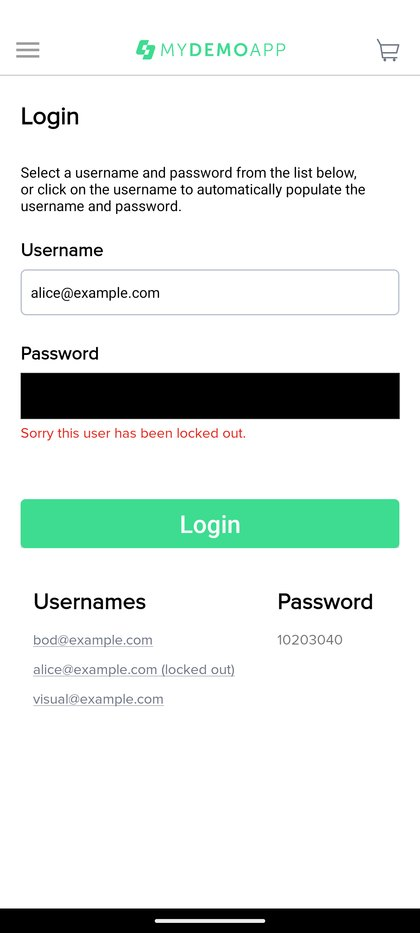
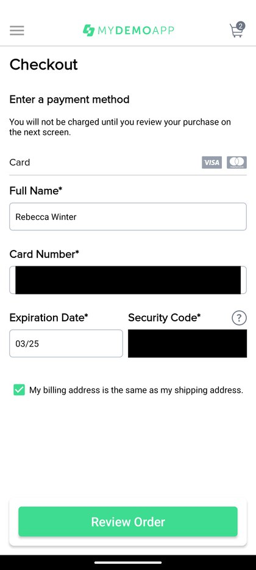
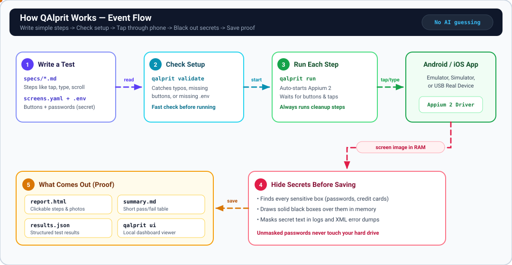

<p align="center">
  
</p>

<h1 align="center">QAlprit (<code>qalprit</code>)</h1>

<p align="center">
  <strong>Mobile QA. Bugs caught with proof.</strong>
</p>

<p align="center">
  <a href="https://qalprit.vattitude.ca"></a>
  <a href="https://pypi.org/project/qalprit/"></a>
  <a href="https://www.python.org/downloads/"></a>
  <a href="https://github.com/vattitude-me/QAlprit/blob/main/LICENSE"></a>
</p>

**QAlprit** tests Android and iOS apps automatically. You write plain steps like `tap` and `type` in Markdown files, QAlprit clicks through the app on a real phone or emulator, blacks out passwords and credit cards before saving screenshots, and saves a report showing every step.

No AI guessing runs during your tests—every run follows your exact steps.

---

## Prerequisites

Make sure these are installed on your computer before running tests:

- **Python 3.10+**
- **Node.js + Appium 2**:
  ```bash
  npm install -g appium
  appium driver install uiautomator2   # for Android
  appium driver install xcuitest       # for iOS (macOS only)
  ```
- **Phone / Emulator tools**:
  - **Android**: Android Studio (ADB + an Android Virtual Device, or a USB phone)
  - **iOS (macOS only)**: Xcode + iOS Simulator

---

## Install

```bash
pip install qalprit
```

Or run from a local clone of this repo:

```bash
git clone https://github.com/vattitude-me/QAlprit.git
cd QAlprit
python3 -m venv .venv
source .venv/bin/activate
pip install -e ".[dev]"
```

---

## How to Run

1. **Copy the sample secrets file** (stays local, ignored by git):
   ```bash
   cp config/env.example .env
   ```

2. **Add an app to test** inside `apps/`:
   - For the included demo suite, download `mda-2.3.0-27.apk` from [Sauce Labs My Demo App](https://github.com/saucelabs/my-demo-app-android/releases) and save it at `apps/mda-2.3.0-27.apk`.

3. **Check your tools and connected phones/emulators**:
   ```bash
   qalprit doctor
   qalprit devices
   ```

4. **Check your test files before launching an app**:
   ```bash
   qalprit validate --suite mda --env mda
   ```

5. **Run the tests**:
   ```bash
   qalprit run --platform android --device android_emulator --app apps/mda-2.3.0-27.apk --env mda --suite mda
   ```

6. **Browse past runs locally** (optional):
   ```bash
   qalprit ui
   ```

---

## What Comes Out

Every run creates a folder under `results/<run-id>/` with your proof:

- **`report.html`** — Open in any browser to see pass/fail results and click through step screenshots.
- **`summary.md`** — Short results table ready to paste into a pull request.
- **`screenshots/`** — Step screenshots with passwords and sensitive boxes blacked out before saving.
- **`results.json`** & **`appium.log`** — Raw test data and Appium logs for debugging.

### Real Sample Output (Sauce Labs My Demo App)

See all 5 passing Android tests in the [Live Sample Report](https://qalprit.vattitude.ca/sample-report) or [examples/mda-sample-run](https://github.com/vattitude-me/QAlprit/blob/main/examples/mda-sample-run/README.md):

<table>
  <tr>
    <td align="center" width="50%">
      <br />
      <sub><strong>MDA-002:</strong> Password blacked out; error message verified.</sub>
    </td>
    <td align="center" width="50%">
      <br />
      <sub><strong>MDA-004:</strong> Card number and CVV blacked out in memory.</sub>
    </td>
  </tr>
</table>

---

## Technical Documentation

### Event Flow Diagram



1. **App Build**: Package the target mobile binary (`.apk`, `.app`, or `.ipa`).
2. **AI Authoring**: Generate screen locators (`screens/screens.yaml`), reusable flows (`flows/*.yaml`), and test specs (`specs/*.md`).
3. **Validate**: Review with human + `qalprit validate` to catch schema, locator, and `.env` issues before execution.
4. **Workflow Execution**: Run each workflow deterministically via Appium 2 on a simulator/emulator or real USB device.
5. **Capture & Mask**: Capture screen frames and mask sensitive fields/PII in memory before saving.
6. **Report & Dashboard**: Generate `report.html`, `summary.md`, `results.json`, and explore runs in `qalprit ui`.

### CLI Reference

| Command | What it does |
|---|---|
| `qalprit doctor` | Checks Python, Node, Appium 2, and Android/iOS tools |
| `qalprit devices` | Lists connected phones, emulators, and simulators |
| `qalprit inspect --platform android\|ios` | Reads the current app screen and suggests locators |
| `qalprit validate --suite <name> --env <name>` | Checks specs, flows, locators, and `.env` without a phone |
| `qalprit run --platform android\|ios --device <name> --app <path>` | Runs tests and generates proof reports |
| `qalprit report <results-dir>` | Rebuilds `report.html` and `summary.md` from `results.json` |
| `qalprit ui` | Opens a local web dashboard for past runs and specs |

### More Docs

- [Authoring Guide](https://github.com/vattitude-me/QAlprit/blob/main/docs/authoring-guide.md) — Step vocabulary, reusable flows, and iOS reset tips
- [Editable Diagram (Draw.io)](https://github.com/vattitude-me/QAlprit/blob/main/docs/architecture.drawio)
- [Contributing](https://github.com/vattitude-me/QAlprit/blob/main/CONTRIBUTING.md) · [Security](https://github.com/vattitude-me/QAlprit/blob/main/SECURITY.md) · [MIT License](https://github.com/vattitude-me/QAlprit/blob/main/LICENSE)

```bash
pytest -v   # run unit tests
```

---

<sub><strong>QAlprit</strong> (<a href="https://qalprit.vattitude.ca">qalprit.vattitude.ca</a>) — Managed by <a href="https://vattitude.ca">vattitude.ca</a></sub>
