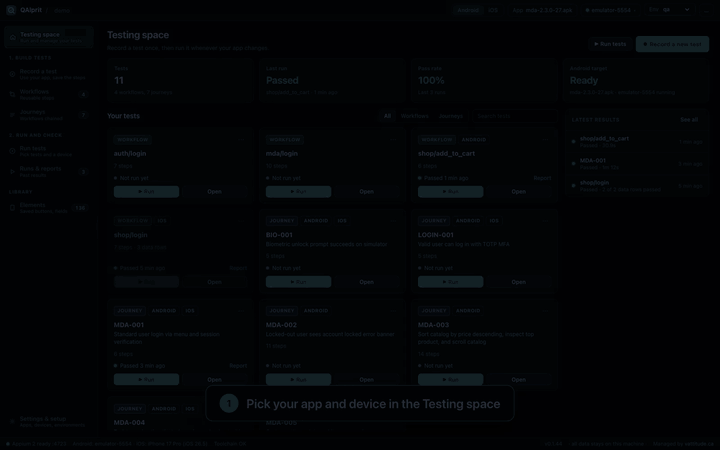
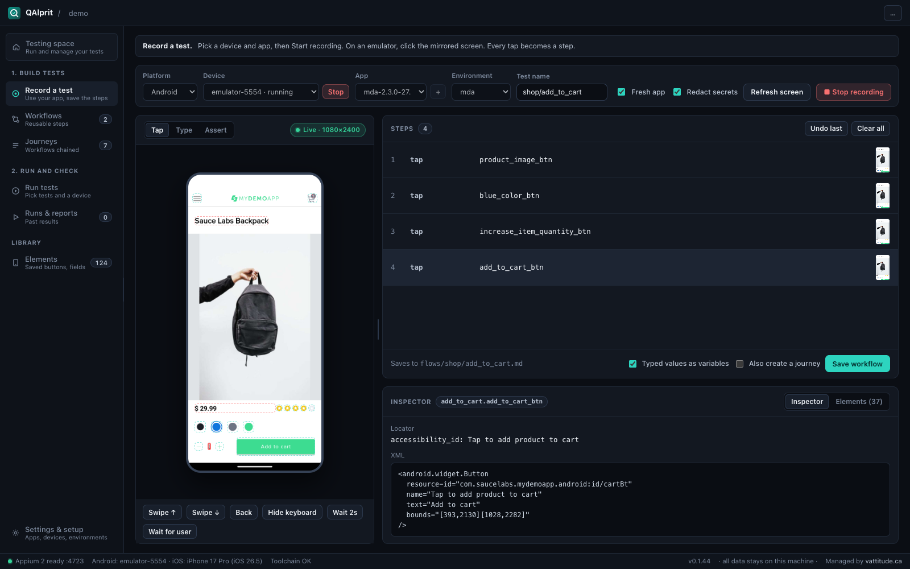
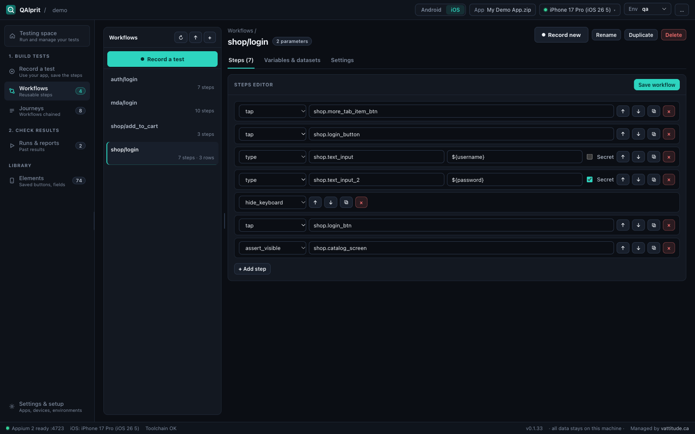
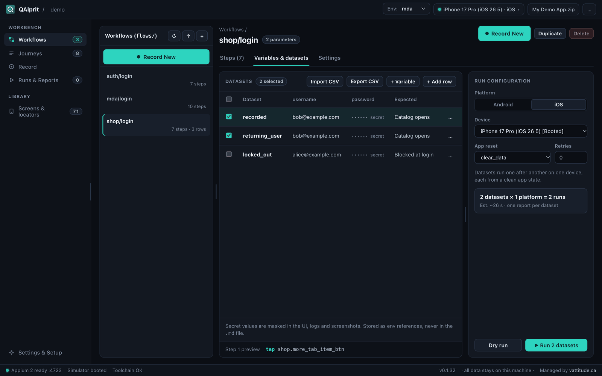
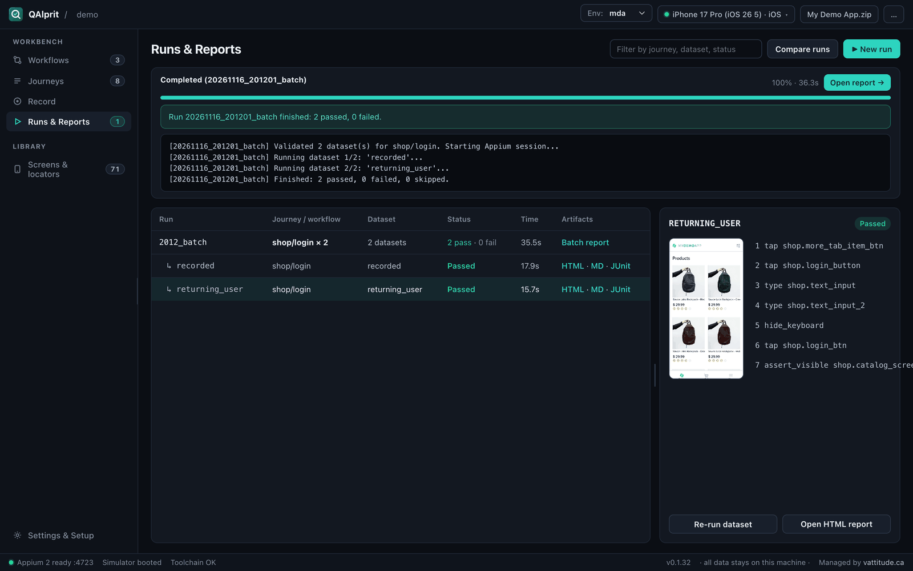
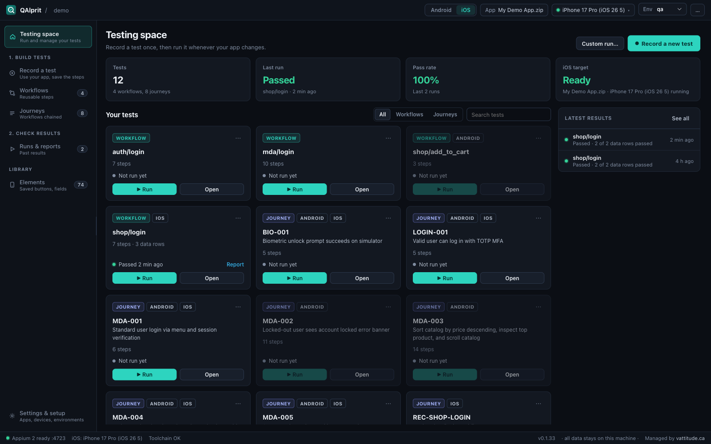
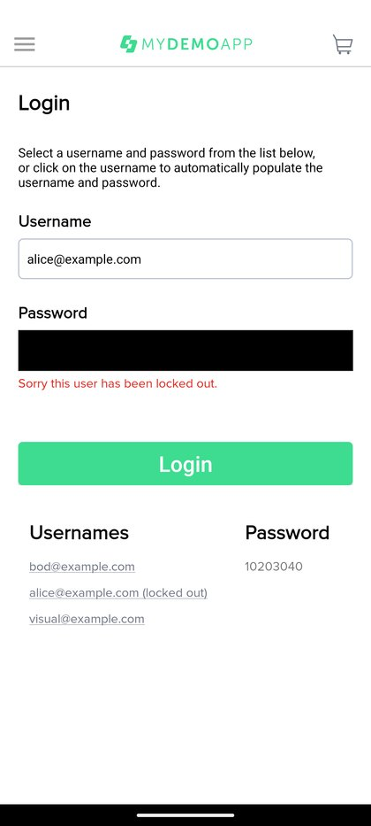
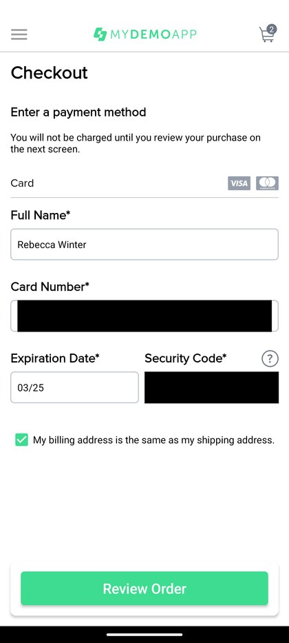
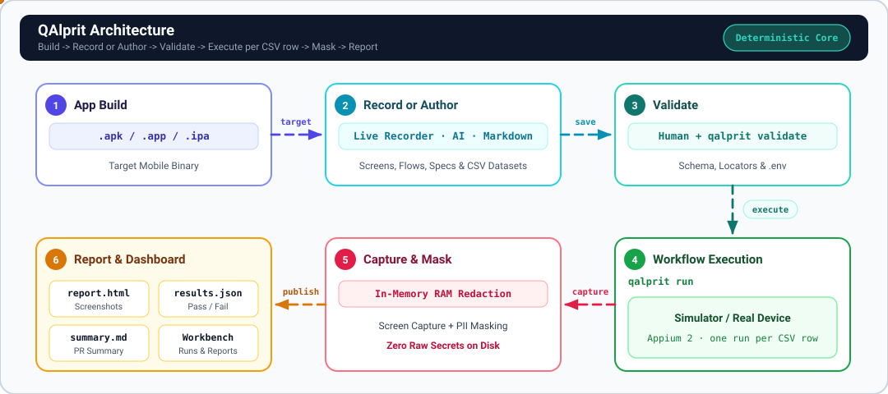

<p align="center">
  
</p>

<h1 align="center">QAlprit</h1>

<p align="center">
  <strong>Mobile QA. Bugs caught with proof.</strong><br />
  Record a test by clicking through your app. Replay it on Android and iOS. Get a report with a screenshot of every step.
</p>

<p align="center">
  <a href="https://qalprit.vattitude.ca"></a>
  <a href="https://github.com/vattitude-me/QAlprit/releases/latest"></a>
  <a href="https://pypi.org/project/qalprit/"></a>
  <a href="https://github.com/vattitude-me/QAlprit/blob/main/LICENSE"></a>
</p>

<p align="center">
  <a href="https://qalprit.vattitude.ca"></a><br />
  <sub>One minute tour. <a href="https://raw.githubusercontent.com/vattitude-me/QAlprit/main/web/media/intro.mp4">Watch the full video</a>.</sub>
</p>

QAlprit is a desktop app for testing Android and iOS apps. You do not write test scripts. You open your app on an emulator or simulator inside the Workbench, click through it once, and QAlprit saves those clicks as a test you can run again whenever the app changes.

- **Click to record.** The Workbench mirrors the device screen. Click a button to record a tap, click a field to record typing, click a label to record a check.
- **One test, many inputs.** Text you type becomes a variable. Add rows to a table and the same test runs once per row.
- **Secrets stay hidden.** Password and card fields are blacked out in screenshots and masked in logs and reports.
- **Same steps every run.** Nothing is guessed at run time, so a failure means the app changed.
- **Runs on your machine.** Your app, test data and screenshots never leave it.

---

## Get started in five minutes

### 1. Install the desktop app

Download the installer from the [latest release](https://github.com/vattitude-me/QAlprit/releases/latest):

| Your computer | File | Tests |
|---|---|---|
| macOS (Apple silicon) | `QAlprit-<version>-macos-arm64.dmg` | Android and iOS |
| Windows 10 or 11 | `QAlprit-Setup-<version>-win64.exe` | Android |

The app bundles Appium 2, Node and Java, so there is nothing else to install for Android. iOS testing needs Xcode with an iOS Simulator, which is why it is macOS only.

On first launch a welcome guide asks three things: Android or iPhone, which app file, and which device. Then it opens the recorder. If you have tests already, click **Skip to Testing space**. **Settings & setup** checks your toolchain and can create an Android emulator for you with one click.

### 2. Record a test

Click **Record a new test** (or go to **Record a test**), pick the platform, the device and your app file (`.apk` for Android, `.app` or `.zip` for the iOS Simulator), and click **Start recording**. QAlprit boots the device if it is off, installs the app and shows it live.

Now use the app the way a customer would:

- **Tap** mode records a tap on whatever you click.
- **Type** mode asks for text and enters it. Tick **Secret** for passwords.
- **Assert** mode records a check that the element you click is on screen.
- The buttons under the phone add swipes, back, hide keyboard and a short wait.

Every click shows up as a step on the right. You can reorder, duplicate, edit or delete steps before you save. If iOS shows a "Save Password" sheet, the recorder dismisses it for you.

**Record on your Android phone.** If your app is already installed and signed in on a phone, you don't need to set it up again on an emulator. Turn on USB debugging, plug the phone in and pick it in **Device**; it shows as *USB phone*. No app file is needed. **Restart app** reopens the app without clearing its data. Then use the phone itself: taps, long presses, swipes, typing and Back (edge swipe or Back key) are recorded as steps. Pause about a second on each new screen so the recorder can read it. Tests recorded this way are saved with `reset: none`, so a replay on the same phone keeps your login. The phone must be upright, and the recorder ignores Home, recents and two-finger gestures. iPhones can't report touches this way, so on iOS you still click the mirror.

<p align="center">
  
</p>

### 3. Save it as a workflow

Click **Save workflow**. QAlprit names the elements you touched, stores how to find them, and turns everything you typed into variables such as `${username}` and `${password}`.

<p align="center">
  
</p>

### 4. Add test data

Open the workflow and go to **Variables & datasets**. The values you typed while recording are already there as the first row. Click **Add row** for more cases, or **Import CSV** to bring in a spreadsheet. Secret columns show as dots.

<p align="center">
  
</p>

### 5. Run and read the report

Tick the rows you want, choose Android or iOS, and click **Run**. Each row runs from a clean app state. **Runs & reports** shows a result per row with the final screen, and links to the full HTML report, a Markdown summary and JUnit XML for CI.

<p align="center">
  
</p>

### 6. Check the screenshots against Jira or Confluence

Every recorded step keeps a screenshot of the screen it led to (`references/flows/<workflow>/`). Each replay puts its own screenshot next to the recorded one, with how much the screen changed.

To check them against your requirements, connect Jira and Confluence once under **Settings & setup → Jira & Confluence**: the site address, plus an API token (with your account email) or a personal access token (PAT). Jira and Confluence can each have their own token. **Test connection** tells you whether each one works. The tokens are saved in the workspace `.env`, sent only to your site, and never shown again. Then add the Jira issues and Confluence pages (for example `SHOP-142`, or a page link) under **Settings → References** on each workflow or journey. A journey also uses the links of the workflows it runs. The same settings can be written by hand in `.env`:

```bash
ATLASSIAN_BASE_URL=https://your-site.atlassian.net
ATLASSIAN_EMAIL=you@example.com        # leave out for a PAT
ATLASSIAN_API_TOKEN=...
# Optional, per product: JIRA_EMAIL, JIRA_API_TOKEN, CONFLUENCE_EMAIL, CONFLUENCE_API_TOKEN
ANTHROPIC_API_KEY=...
```

Then tick **Check screenshots with AI** when you run, or click **Review → Check with AI** on a finished run. The model compares each step's replay with the recording and with the Jira or Confluence text, and gives each step *pass*, *fail* or *unclear* with a reason. You confirm or correct each one with **Looks right** or **Wrong**. The AI check never changes a test's pass or fail, and its verdicts and your decisions go into the HTML report. Screenshots leave your computer with secret fields already blacked out. Pick who does the check with the **Provider** menu, `--ai-provider`, or `QALPRIT_AI_PROVIDER` in `.env`: `anthropic` (the Anthropic API, needs `ANTHROPIC_API_KEY`, the default), `agy` (the Antigravity CLI) or `copilot` (the GitHub Copilot CLI). The two CLIs use their own sign-in, so QAlprit needs no key for them. From the command line: `qalprit run ... --ai-review --ai-provider agy`, or `qalprit review results/<run-id> --ai-provider copilot` afterwards. `qalprit refs --id <TEST-ID>` fetches the references on their own.

When you record on a USB phone you can open any app from the home screen: opening an app becomes a `launch` step, so the replay opens it the same way.

---

## What the Workbench gives you

<p align="center">
  
</p>

| View | What you do there |
|---|---|
| **Testing space** | See every test as a card, run it in one click, rename, duplicate or delete it, and check the latest results |
| **Record a test** | Mirror a live emulator, simulator or USB phone and capture steps by clicking |
| **Workflows** | Edit recorded steps, manage variables and CSV datasets, run one or many rows |
| **Journeys** | Chain workflows into end-to-end tests and tag them into suites |
| **Runs & reports** | Watch a run live, open reports, compare two runs, delete old runs |
| **Elements** | Search every saved button and field, see how it is found on Android and iOS, delete unused ones |
| **Settings & setup** | Check the toolchain, create emulators, manage environments and app files |

## What comes out

Every run creates a folder under `results/<run-id>/` with your proof:

- **`report.html`**: Open in any browser to see pass/fail results, failure categories, and step screenshots.
- **`summary.md`** & **`junit.xml`**: Markdown results table for pull requests plus JUnit XML for CI pipelines.
- **`screenshots/`**: Step screenshots with passwords and sensitive boxes blacked out in memory before saving.
- **`results.json`** & **`appium.log`**: Structured test data (`schema_version: 1.1`) and scrubbed Appium logs.

### Real sample output (Sauce Labs My Demo App)

See all 5 passing Android tests in the [Live Sample Report](https://qalprit.vattitude.ca/sample-report) or [examples/mda-sample-run](https://github.com/vattitude-me/QAlprit/blob/main/examples/mda-sample-run/README.md):

<table>
  <tr>
    <td align="center" width="50%">
      <br />
      <sub><strong>MDA-002:</strong> Password blacked out; error message verified.</sub>
    </td>
    <td align="center" width="50%">
      <br />
      <sub><strong>MDA-004:</strong> Card number and CVV blacked out in memory.</sub>
    </td>
  </tr>
</table>

---

## For engineers: CLI, CI and plain-text tests

Everything the Workbench saves is a plain text file in your project folder, so tests live in git and run in CI without the desktop app.

| File | Holds |
|---|---|
| `flows/<name>.md` | A recorded workflow, with `platforms:` set to where you recorded it |
| `screens/screens.yaml` | Element locators, with separate `android:` and `ios:` entries |
| `datasets/flows/<name>.csv` | One row per test case. A cell can hold `${QA_PASS}` to read a real credential from `.env` |
| `specs/<suite>/*.md` | Journeys that call workflows |

Install the Python package to run the same tests from a terminal or pipeline:

```bash
pip install qalprit
npm install -g appium
appium driver install uiautomator2   # Android
appium driver install xcuitest       # iOS, macOS only

qalprit ui                           # the same Workbench, in your browser (workspace: ~/Documents/QAlpritWorkspace)
qalprit doctor                       # check Python, Node, Appium and device tools
qalprit validate --suite mda --env mda
qalprit run --platform android --device android_emulator --app apps/mda-2.3.0-27.apk --env mda --suite mda
```

The CLI needs Python 3.10+, Node.js, and either Android Studio (ADB plus an emulator or USB phone) or Xcode with an iOS Simulator.

To try the bundled sample suite, copy `config/env.example` to `.env` and download `mda-2.3.0-27.apk` from [Sauce Labs My Demo App](https://github.com/saucelabs/my-demo-app-android/releases) into `apps/`.

You can also hand the work to an AI coding agent (Claude Code, Codex, Cursor, Copilot, Antigravity). Paste:

> Follow [Agent Instructions](https://github.com/vattitude-me/QAlprit/blob/main/docs/agent-instructions.md) to run QAlprit against `apps/<your-app.apk-or-.app>` on `<android|ios>`. Fix any broken locators or keyboard issues without hiding real app bugs, and open my final `report.html`.

To work on QAlprit itself:

```bash
git clone https://github.com/vattitude-me/QAlprit.git
cd QAlprit
python3 -m venv .venv && source .venv/bin/activate
pip install -e ".[dev]"
pytest -v
```

---

## Technical documentation

### Event flow



1. **App Build**: Package the target mobile binary (`.apk`, `.app`, or `.ipa`).
2. **Record**: Click through the app on a live emulator in the Workbench. QAlprit saves screen locators (`screens/screens.yaml`), reusable flows (`flows/*.md`), test specs (`specs/*.md`), and CSV datasets (`datasets/`).
3. **Validate**: Review with human + `qalprit validate` to catch schema, locator, and `.env` issues before execution.
4. **Workflow Execution**: Run each workflow deterministically via Appium 2 on a simulator/emulator or real USB device, once per selected CSV row.
5. **Capture & Mask**: Capture screen frames and mask sensitive fields/PII in memory before saving (`secure_evidence: true`).
6. **Report & Dashboard**: Generate `report.html`, `summary.md`, `junit.xml`, `results.json`, and explore or compare runs in `qalprit ui`.

### CLI reference

| Command | What it does |
|---|---|
| `qalprit doctor` | Checks Python, Node, Appium 2, and Android/iOS tools |
| `qalprit devices` | Lists connected phones, emulators, and simulators |
| `qalprit list [--suite <name>]` | Lists test specs, reusable flows, and screen locators (`--json-output` supported) |
| `qalprit inspect --platform android\|ios` | Reads the current app screen and ranks suggested locators (`--export-json` supported) |
| `qalprit validate --suite <name> --env <name>` | Checks specs, flows, locators, and `.env` without a phone (`--app` optional) |
| `qalprit run --platform android\|ios --device <name> --app <path>` | Runs tests (`--id`, `--exclude-tags`, `--rerun-failed`, `--dry-run`, `--update-baselines`) |
| `qalprit report <results-dir>` | Rebuilds `report.html`, `summary.md`, and `junit.xml` from `results.json` |
| `qalprit ui` | Opens the Workbench in your browser: record flows, edit datasets, run, and compare reports. It uses the workspace saved in Settings (default `~/Documents/QAlpritWorkspace`), never the current folder. Pass `--workspace <folder>` to open another one |

### More docs

- [AI Agent Instructions](https://github.com/vattitude-me/QAlprit/blob/main/docs/agent-instructions.md): Prompt and runbook so an AI coding agent can run & maintain QAlprit for you
- [Authoring Guide](https://github.com/vattitude-me/QAlprit/blob/main/docs/authoring-guide.md): Step vocabulary, reusable flows, CSV datasets, and iOS reset tips
- [Editable Diagram (Draw.io)](https://github.com/vattitude-me/QAlprit/blob/main/docs/architecture.drawio)
- [Contributing](https://github.com/vattitude-me/QAlprit/blob/main/CONTRIBUTING.md) · [Security](https://github.com/vattitude-me/QAlprit/blob/main/SECURITY.md) · [MIT License](https://github.com/vattitude-me/QAlprit/blob/main/LICENSE)

---

<sub><strong>QAlprit</strong> (<a href="https://qalprit.vattitude.ca">qalprit.vattitude.ca</a>). Managed by <a href="https://vattitude.ca">vattitude.ca</a></sub>
